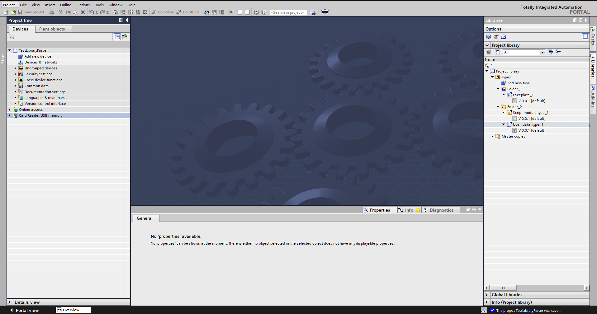
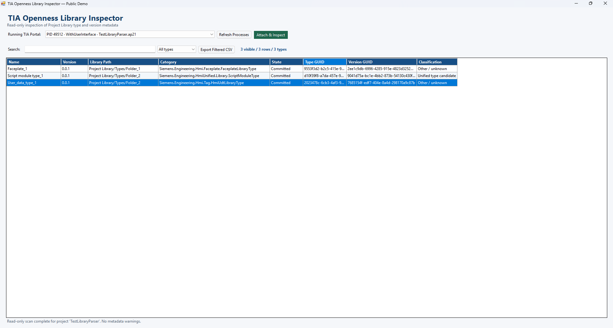

# TIA Portal Project Library Parser — Public Demo

A read-only C# engineering utility demonstrating how Siemens TIA Portal library metadata can be inspected programmatically through TIA Openness.

The application attaches to an already running TIA Portal V20 or V21 process, reads the open project's (single-user project or Multiuser local session) **Project Library → Types** tree recursively, and displays library type/version metadata in a searchable table.

## What it inspects

- Running TIA Portal processes and their open-project state.
- Project Library type folders and nested user folders.
- Library type name, folder path, runtime category, and GUID.
- Visible versions, version state, and version GUID.
- Runtime-type evidence indicating a possible WinCC Unified type or faceplate.

Results can be searched, filtered by Unified classification, counted, and exported to CSV.

## Requirements

- Windows x64.
- .NET Framework 4.8 developer pack/runtime.
- Siemens TIA Portal V20 or V21 with Openness installed (the build targets one version, see Build).
- A user account authorized for TIA Portal Openness.
- An already running TIA Portal instance of that version with a project or a Multiuser local session open.

Siemens assemblies are **not** included. The project references the `Siemens.Engineering*.dll` assemblies from the user's local TIA Portal installation with `Private=false`:

| Version | Standard PublicAPI folder | Main assembly | Override |
|---|---|---|---|
| V21 (default) | `%ProgramFiles%\Siemens\Automation\Portal V21\PublicAPI\V21\net48` | `Siemens.Engineering.Base.dll` | `TIA_PORTAL_V21_PUBLIC_API` |
| V20 | `%ProgramFiles%\Siemens\Automation\Portal V20\PublicAPI\V20` | `Siemens.Engineering.dll` | `TIA_PORTAL_V20_PUBLIC_API` |

To use another installation directory, set for example:

```powershell
$env:TIA_PORTAL_V20_PUBLIC_API = "<local V20 PublicAPI folder>"
```

The same variable is read at run time to locate the assemblies.

Do not copy Siemens DLLs into this repository.

## Build

From a Visual Studio Developer PowerShell or a machine with the .NET SDK and .NET Framework 4.8 targeting pack:

```powershell
# TIA Portal V21 (default)
dotnet build .\TiaOpennessLibraryInspectorDemo.csproj --configuration Release -p:Platform=x64

# TIA Portal V20
dotnet build .\TiaOpennessLibraryInspectorDemo.csproj --configuration Release -p:Platform=x64 -p:TiaPortalVersion=20
```

The application is built as x64, one build per TIA Portal version. Build output remains under `bin\x64\Release\V<version>\net48` and is ignored by Git. A build only attaches to TIA Portal processes of its own version.

## Demo

### TIA Portal Project Library



### Library Inspector



## Run

1. Start TIA Portal V20 or V21 (the version the build targets).
2. Open a disposable or fictional project containing Project Library types, or a Multiuser local session (`.als20` / `.als21`): a local session is not listed in `Projects`, so it is read through `LocalSessions`.
3. Start `TiaOpennessLibraryInspectorDemo.exe`.
4. Select **Refresh Processes**.
5. Select the correct TIA process and choose **Attach & Inspect**.
6. Approve the normal Openness authorization prompt if TIA Portal displays it.
7. Search/filter the table or export the visible rows to CSV.

## Read-only safety

The inspection path calls only process discovery/attachment and property or collection reads. It does not call project save, object create/delete, import/export, library update, attribute setters, project creation, or project upgrade APIs.

The attached Openness session is disposed immediately after the in-memory metadata scan. Disposing the attached session does not request the running TIA Portal process or project to close.

CSV exports reflect metadata from the attached project and may be confidential. Review them before sharing, and never commit exports from a real production project; `*.csv` is ignored by default.

## Siemens-independent checks

Filtering, recursive path handling, runtime-type classification, unique counts, and CSV escaping are kept independent from Siemens assemblies:

```powershell
dotnet run --project .\tests\InspectorLogic.Tests.csproj --configuration Release
```

Cloud CI runs only these checks. The full application requires a local licensed TIA Portal installation, so proprietary Siemens assemblies are not uploaded for CI.

## Limitations

- Targets TIA Portal V20 or V21, one build per version.
- V20: the `TypeObject` runtime-type hint of each version is read through reflection; when the API does not expose it, classification uses the library type's own runtime type only.
- Inspects Project Library types, not every object in a TIA project.
- Produces one table row per visible library type version.
- Unified classification is a conservative hint based on API runtime-type metadata; it is not a guarantee of the exact engineering object category.
- Metadata unavailable through the installed API is left blank and counted as a warning.
- CSV export contains the currently filtered rows.
- No background scan or production-scale performance claim is made.

## Public Demo vs Extended/Internal tooling

This public demo contains only process attachment, recursive metadata reads, table filtering, and CSV export. It intentionally excludes project generation, screens, faceplate placement, imports, synchronization, project modification, proprietary mappings, customer structures, production reports, and advanced classification logic.

This is an independent project and is not an official Siemens product. Siemens and TIA Portal are trademarks of their respective owner.

## Author

**Nikolaos Stefanopoulos**  
Email: nikstefanopoulos12@gmail.com

## License

This project is licensed under the [MIT License](LICENSE).
